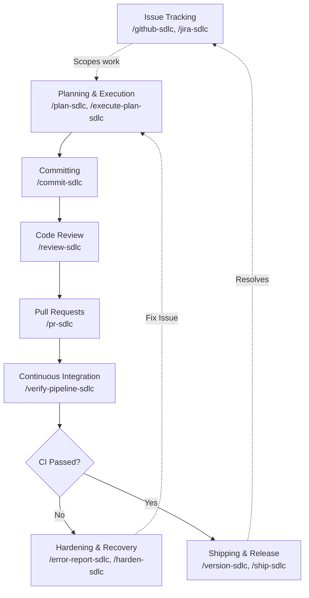
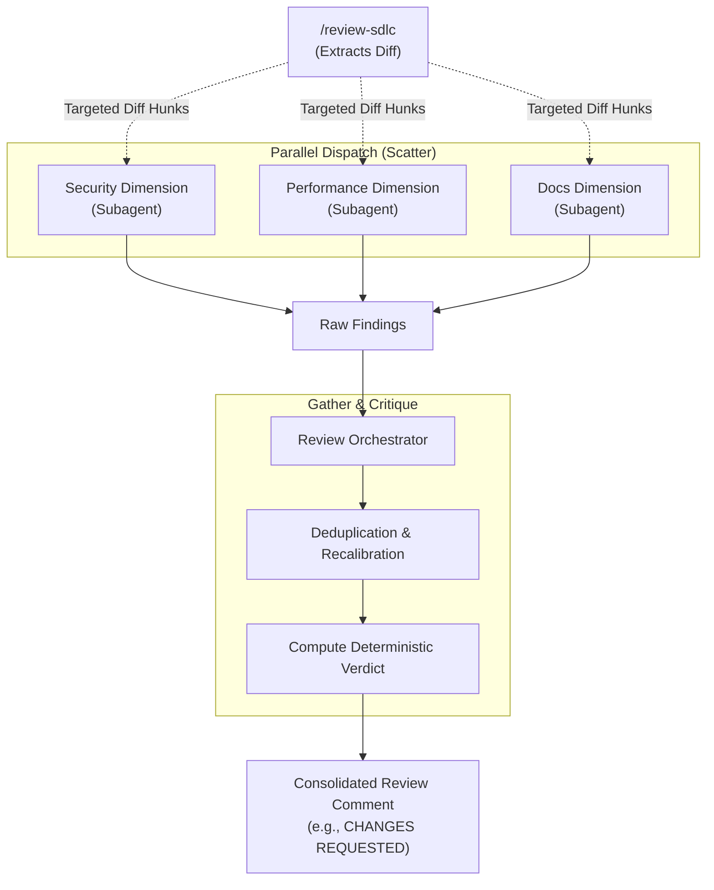

# Lift-SDLC — Antigravity Agentic SDLC Plugin

> 🚀 **Native SDLC pipeline for Antigravity agents** — plan, commit, review, PR, ship, all from chat. Take work from issue to shipped release without leaving your editor.

[](LICENSE)

Lift-SDLC is a comprehensive suite of skills and commands for Software Development Lifecycle (SDLC) workflows — planning, execution, commits, code review, pull requests, CI verification, and releases — that run natively inside Google Antigravity. It is an Antigravity-native, cross-platform (POSIX and Windows) rewrite inspired by [`rnagrodzki/sdlc-marketplace`](https://github.com/rnagrodzki/sdlc-marketplace), rebuilt as a flat, single plugin for the Antigravity platform.

## See It In Action

Writing code and managing your release lifecycle has never been simpler. With Lift-SDLC, you can go from an issue to a Pull Request by calling dedicated skills directly:

> **You:** `/github-sdlc view issue #42`
> 
> **Antigravity:** *(Reads issue #42 "Implement OAuth2 login flow" using the GitHub CLI)*<br>
> I've retrieved the issue details. Let's start with a plan.
> 
> **You:** `/plan-sdlc`
>
> **Antigravity:** *(Generates architecture plan and saves it to `implementation_plan.md`)*<br>
> Here is the implementation plan for OAuth2. Does this look good?
>
> **You:** Looks perfect, go ahead. `/execute-plan-sdlc`
>
> **Antigravity:** *(Executes the plan, runs tests, and stages the files)*<br>
> OAuth2 flow implemented successfully!
>
> **You:** `/commit-sdlc`
>
> **Antigravity:** *(Analyzes staged files and commits)*<br>
> 📝 **Auto-generated Commit:** `feat(auth): implement OAuth2 login flow (#42)`
>
> **You:** `/pr-sdlc`
>
> **Antigravity:** *(Runs GitHub PR flow)*<br>
> 🚀 **Pull Request created!** The PR description has been automatically populated with the business context and linked to Issue #42.

## Installation

You can install this plugin either globally for all workspaces, or locally for a specific workspace.

### Global Installation (Recommended)

To make the plugin available in all your Antigravity workspaces, clone this repository into your global Antigravity plugins directory:

```bash
git clone https://github.com/dnichyparuk/lift-sdlc.git ~/.gemini/config/plugins/sdlc
```

> **IDE vs. CLI paths.** `~/.gemini/config/plugins/` is the global location documented for the [Antigravity IDE](https://antigravity.google/docs/plugins/). The [Antigravity CLI docs](https://antigravity.google/docs/cli/plugins/) name `~/.gemini/antigravity-cli/plugins/` instead; in practice the CLI (`agy`) also loads plugins from `~/.gemini/config/plugins/` and lists them in `~/.gemini/config/config.json`, so a single clone serves both. If your CLI version does not pick the plugin up, clone (or symlink) it into the CLI path as well, or run `agy plugin install <path-to-clone>`.

### Workspace Installation

To install the plugin only for a specific workspace, navigate to the root of your project and clone it into the local `.agents` directory:

```bash
mkdir -p .agents/plugins
git clone https://github.com/dnichyparuk/lift-sdlc.git .agents/plugins/sdlc
```

> **Configuration note:** Permissions, plans directory, and other settings are documented in the [Configuration](#configuration) section below.

## Quick Start

Once installed, the SDLC skills are automatically registered with your Antigravity agent and can be invoked from the chat interface. A few common entry points:

- `/commit-sdlc` — Commit staged changes
- `/pr-sdlc` — Create a pull request
- `/review-sdlc` — Review changes
- `/ship-sdlc` — Ship a release

See the [Skills Reference](#skills-reference) for the full catalog of 18 skills.

## SDLC Pipeline Structure

This plugin implements a complete, end-to-end Software Development Lifecycle process natively within the chat interface. The workflow is structured into the following distinct phases:



1. **Planning & Execution** (`/plan-sdlc`, `/execute-plan-sdlc`)
   - Scopes requirements, proposes architectural decisions, and breaks down the work into manageable tasks.
   - Executes the implementation plan systematically while adhering to guardrails.
2. **Committing** (`/commit-sdlc`)
   - Automatically generates smart, conventional commit messages by analyzing your staged diff and recent project history.
3. **Code Review** (`/review-sdlc`)
   - Performs a comprehensive, automated code review of your changes against predefined dimensions (e.g., security, architecture, performance) before you open a Pull Request.
4. **Pull Requests** (`/pr-sdlc`)
   - Generates detailed, well-structured PR descriptions based on the diff and commit history.
5. **Continuous Integration** (`/verify-pipeline-sdlc`)
   - Interfaces with GitHub Actions to monitor, verify, and diagnose CI/CD pipeline runs for your PRs.
6. **Hardening & Recovery** (`/error-report-sdlc`, `/harden-sdlc`)
   - If a pipeline fails or an error occurs, these skills analyze the failure to suggest stronger guardrails, preventing the same class of failure in the future.
7. **Shipping & Release** (`/version-sdlc`, `/ship-sdlc`)
   - Automates semantic versioning, changelog generation, and finalizing the release of the project.

## Skills Reference

The plugin exposes 18 skills (17 user-invocable slash commands plus 1 internal skill) for managing your workflows. Skills inherit the active session model (`SKILL.md` omits `model:` frontmatter because `agy` ignores it) and pass explicit `Model` enums (`flash_lite`, `flash`, `pro`, `inherit`) when dispatching subagents via `invoke_subagent`.

| Skill | Default / Subagent Model | Description |
|---|---|---|
| `/setup-sdlc` | `inherit` | Initializes guardrails, code review dimensions, and templates for a project. |
| `/plan-sdlc` | `inherit` (`flash` / `pro` subagents) | Scopes requirements and generates structured implementation plans. |
| `/plan-guide-sdlc` | `inherit` | Deploys canonical `PLAN_GUIDELINES.md` and links it in `AGENTS.md`. |
| `/catalog-sdlc` | `inherit` | Indexes delivery plans and generates `delivery-graph.json` and the HTML delivery dashboard. |
| `/execute-plan-sdlc` | `inherit` (`flash_lite` / `flash` / `pro` subagents) | Executes implementation plans systematically while adhering to guardrails. |
| `/commit-sdlc` | `inherit` (`flash_lite` orchestrator) | Generates smart, conventional commit messages and executes commits. |
| `/review-sdlc` | `inherit` (`flash_lite` / `flash` / `pro` subagents) | Performs automated code review against project-specific dimensions. |
| `/pr-sdlc` | `inherit` | Generates descriptions and creates pull requests. |
| `/received-review-sdlc` | `inherit` (`flash_lite` / `flash` / `pro` subagents) | Analyzes and processes code review feedback received on an open PR. |
| `/verify-pipeline-sdlc` | `inherit` | Monitors and diagnoses CI/CD pipeline runs for your PRs. |
| `/version-sdlc` | `inherit` | Manages semantic versioning and changelog generation. |
| `/ship-sdlc` | `inherit` (`flash` / `pro` pipeline steps) | Orchestrates the end-to-end shipping process via `pipeline-sdlc`, `pipeline.json`, and native `run_workflow` (`workflows/ship.py`). |
| `/pipeline-sdlc` | `inherit` | Executes declarative workflow manifests (`pipeline.json`) with state transitions and flattened `invoke_subagent` / `run_workflow` dispatch (replaces `run-workflow` to avoid shadowing `agy`'s built-in `/run-workflow`). |
| `/learn-sdlc` | `inherit` (`flash` / `pro` subagents) | Assimilates recurring learnings into strengthened plan/execute guardrails via PR. |
| `/error-report-sdlc` *(internal)* | `inherit` (`flash` orchestrator) | Reports complex failures or plugin defects for upstream tracking. |
| `/harden-sdlc` | `inherit` (`pro` orchestrator) | Analyzes pipeline failures to strengthen guardrails and prevent regressions. |
| `/github-sdlc` | `inherit` | Integrates with GitHub Issues for ticket tracking and updates. |
| `/jira-sdlc` | `inherit` | Integrates with Jira for ticket tracking and updates. |

## Agents Reference

Skills delegate isolated, context-clean subtasks to specialized agents. There are two categories:

### Registered Plugin Agents (12)

These 12 agents are defined in `agents/*.md` (frontmatter `subagent: true`) and dispatched by `name` through the native `invoke_subagent` tool. They inherit no conversation context — inputs arrive through a prepared manifest file or task fact sheet.

> **Host support.** A plugin-bundled `agents/` directory is documented for the [Antigravity CLI](https://antigravity.google/docs/cli/plugins/) and on the [Subagents](https://antigravity.google/docs/subagents/) page (`plugins/<plugin_name>/agents/`), and `agy plugin validate` discovers all of them. The [IDE plugin page](https://antigravity.google/docs/plugins/) lists only skills, rules, MCP servers and hooks, so agent discovery under the IDE is not officially confirmed. Skills that depend on these agents (`/review-sdlc`, `/plan-sdlc`, `/execute-plan-sdlc`, `/commit-sdlc`, `/harden-sdlc`, `/received-review-sdlc`, `/learn-sdlc`) are verified under the CLI.

| Agent | Dispatched by | Model (`agy` enum / Gemini 4) | Role |
|---|---|---|---|
| **Plan explore orchestrator** | `/plan-sdlc` | `flash` (`gemini-4-hydrogen-high`) | Derives 3–7 task-specific discovery dimensions and fans out parallel code/web/hybrid sub-agents to produce `discovery-brief.md`. |
| **Plan generation orchestrator** | `/plan-sdlc` | `pro` (`gemini-4-carbon-medium` / `carbon-high` / `argon-medium`) | Receives the exploration brief and writes the structured `implementation_plan.md` file. |
| **Plan execution validator** | `/execute-plan-sdlc` | `pro` (`gemini-4-argon-low`) | Validates plan integrity (circular deps, vague deliverables) and wave structure (file conflicts, risk clustering). Called twice per execution run. |
| **Task implementer** | `/execute-plan-sdlc` | `flash` / `pro` (tier-routed) | Implements a single plan task from its fact sheet, runs verification, and returns a structured completion checklist. |
| **Spec compliance reviewer** | `/execute-plan-sdlc` | `pro` (`gemini-4-argon-low` / `argon-medium`) | Reviews wave or cross-wave implementations directly against plan tasks and OpenSpec delta specs. |
| **Commit orchestrator** | `/commit-sdlc` | `flash_lite` (`gemini-4-hydrogen-low`) | Reads the staged diff and commit history from a prepared manifest and returns a single, self-critiqued commit message string. |
| **Review orchestrator** | `/review-sdlc` | `flash` (`gemini-4-hydrogen-high`) | Reads the review manifest, dispatches dimension sub-agents in parallel, deduplicates and critiques findings, and persists `review-comment.md`. |
| **Received-review orchestrator** | `/received-review-sdlc` | `flash` (`gemini-4-hydrogen-medium`) | Reads the received-review manifest, fans out per-file verifier sub-agents, persists the verification report, and returns a bounded `VERIFY_SUMMARY` token. |
| **Harden orchestrator** | `/harden-sdlc` | `pro` (`gemini-4-argon-low`) | Classifies a pipeline failure as `user-code`, `plugin-defect`, or `ambiguous`, then emits strengthen-only hardening proposals as JSON. |
| **Error report orchestrator** | `/error-report-sdlc` | `flash` (`gemini-4-hydrogen-medium`) | Fills the `ToolingError.md` issue template from a prepared manifest and returns `{title, body}` JSON for posting to the plugin tracker. |
| **Learn synthesis orchestrator** | `/learn-sdlc` | `pro` (`gemini-4-argon-medium`) | Synthesizes candidate strengthen-only guardrail additions from recurring pending learning signatures. |
| **Learn review-only** | `/learn-sdlc` | `flash` (`gemini-4-hydrogen-high`) | Read-only pre-screen assessment checking synthesized guardrails for soundness and regression risks. |

### Ad-hoc Subagents (`self` / `research`)

These subagents have no file in `agents/` and are dispatched via `invoke_subagent` with `TypeName: "self"` or `"research"` using inline prompt templates. They are implementation details of their parent orchestrators.

| Subagent | Model | Role |
|---|---|---|
| **Wave runner** | `flash` (`gemini-4-hydrogen-medium`) | Executes one wave: fans out `task-implementer` agents in parallel, handles per-task retries along `flash_lite → flash → pro`, and emits a bounded `WAVE_SUMMARY` token. |
| **Review sub-agent** | Configured in `.sdlc/local.json` (`review.subagent_model`), fallback: `gemini-4-hydrogen-medium` (`flash`); supports per-dimension `model:` override | Reviews the diff for one code review dimension and returns a structured findings list. |
| **Discovery sub-agent** | `flash` / `pro` (per dimension) | Explores code or web sources for one planning dimension and returns `F-<DIM>-<n>` tagged findings. |

> **Model escalation (coding agents):** On failure, the wave-runner escalates the task's `agy` model enum one step per retry, up to 2 retries, along the fixed ladder `flash_lite → flash → pro`: `flash_lite → flash → pro`, `flash → pro → pro (+ failure context)`, `pro → pro (+ failure context) → FAILED`.

## Multi-Dimension Code Review

The `/review-sdlc` skill implements a sophisticated "scatter-gather" review architecture designed to maximize thoroughness while minimizing noise, hallucinations, and context window exhaustion.



- **Project-Defined Dimensions:** Code reviews are driven by project-specific dimensions (e.g., Security, Performance, API Contracts). Each dimension specifies file-matching globs and exact review instructions.
- **Configurable & Dimension-Scoped Models:** Subagents default to the model configured in `.sdlc/local.json` (`review.subagent_model`, fallback `gemini-4-hydrogen-medium` / `flash`). Individual dimension files can specify an explicit `model:` override (e.g., `model: gemini-4-neon-low` / `pro` for critical security or database migration reviews).
- **Parallel Dispatch:** For a given diff, the orchestrator concurrently spawns multiple specialized subagents. This parallelization significantly reduces overall review time.
- **Targeted Diff Scoping:** A subagent does not read the entire codebase or even the full PR diff. It is strictly scoped to receive only the diff hunks for files matching its dimension's triggers. This precise scoping prevents subagents from getting distracted by unrelated changes.
- **Orchestrator Deduplication:** Once subagents complete, a central orchestrator merges the findings. It intelligently deduplicates issues flagged on the same line across different dimensions (keeping the highest severity) and catches contradictory recommendations.
- **Deterministic Verdicts:** The final PR verdict (`CHANGES REQUESTED`, `APPROVED WITH NOTES`, or `APPROVED`) is not an arbitrary LLM guess—it is mathematically computed based on the quantity and severity of the deduplicated findings (e.g., 1 Critical or 3 Highs strictly enforce a `CHANGES REQUESTED` state).

## Quality Modes (`/execute-plan-sdlc`)

When executing a plan, `/execute-plan-sdlc` asks you to select a **quality tier** that controls which model each coding agent runs on. The tier balances speed and cost against correctness.

> **Note on flag names:** The CLI flag values are counter-intuitively named. `--quality minimal` selects the *Speed* preset (cheapest), while `--quality full` selects the *Quality* preset (most capable).

### Tier Overview

Each task is classified as **Trivial**, **Standard**, or **Complex** based on scope. The tier maps that classification to a model:

| Flag | Display name | Use case | Trivial | Standard | Complex |
|---|---|---|---|---|---|
| `--quality minimal` | **Speed** | Fast iteration, drafts, low-stakes changes | `flash` (`gemini-4-hydrogen-medium`) | `flash` (`gemini-4-hydrogen-medium`) | `flash` (`gemini-4-hydrogen-high`) |
| `--quality balanced` | **Balanced** *(default)* | Everyday feature work — Hydrogen trivials, Neon-for-Coding Standard & Complex | `flash` (`gemini-4-hydrogen-medium`) | `pro` (`gemini-4-neon-low`, or `inherit` via `execute.standardWorkerEnum`) | `pro` (`gemini-4-neon-medium`) |
| `--quality full` | **Quality** | Architectural changes, high-risk tasks, production releases | `flash` (`gemini-4-hydrogen-medium`) | `pro` (`gemini-4-neon-medium`) | `pro` (`gemini-4-carbon-medium`) |

> **Trivial batching:** when 2 or more Trivial tasks land in the same wave they are batched into a single agent dispatch running at the tier's Trivial model (`flash` / `gemini-4-hydrogen-medium`). A lone Trivial task runs as an individual agent at the tier's Trivial model.

**Specialized verification & routing agents:**

| Agent | Model | Notes |
|---|---|---|
| **Wave runner** | `flash` (`gemini-4-hydrogen-medium`) | Locked — performs strict routing, verification parsing, and failure-aware retry escalation. |
| **Spec compliance reviewer** | `pro` (`gemini-4-argon-low` / `argon-medium`) | Verifies wave and cross-wave implementations against plan specs and OpenSpec deltas. **Skipped on Speed tier** (`--quality minimal`) and trivial-only waves. |
| **Plan execution validator** | `pro` (`gemini-4-argon-low`) | Validates plan integrity and wave structure. |

### Feature Differences by Tier

| Feature | Speed (`--quality minimal`) | Balanced | Quality (`--quality full`) |
|---|---|---|---|
| Per-wave spec compliance review | ❌ Skipped | ✅ After each non-trivial wave (`pro` / Argon) | ✅ After each non-trivial wave (`pro` / Argon) |
| Final cross-wave spec review | ❌ Skipped | ✅ When >3 waves or issue found (`pro` / Argon) | ✅ When >3 waves or issue found (`pro` / Argon) |
| Tier selection prompt | ✅ Shown (unless `--quality` passed) | ✅ | ✅ |
| Custom per-task model override | ✅ (`custom` option) | ✅ | ✅ |

### Failure-Aware Retry Escalation Ladder

When a coding agent fails, `escalateLogicalModel` (`scripts/lib/model-tiers.js`) routes retries based on the failure signal (max 2 retries per task, with failure context added):
- **`NEEDS_CONTEXT`**: Keeps the current tier and injects the missing context.
- **`SPEC_GAP`**: Jumps directly to Argon (`gemini-4-argon-low` / `pro`, or `gemini-4-carbon-medium` if already Argon/Neon-high/Carbon).
- **`FAILED_TESTS` / `FAILED_BUILD` / `BLOCKED`**: Steps along `hydrogen → neon → argon → carbon` (mapped to `agy` runtime enums `flash_lite → flash → pro`).

| Starting `agy` enum | Retry 1 | Retry 2 | After Retry 2 |
|---|---|---|---|
| `flash_lite` | `flash` | `pro` | FAILED → user |
| `flash` | `pro` | `pro` + failure context | FAILED → user |
| `pro` | `pro` + failure context | `pro` + failure context (logical step) | FAILED → user |

> **Partial batch failure:** if a batch of Trivial tasks partially fails, only the failed tasks are re-dispatched individually with escalation. Completed tasks in the batch are final.

### Usage Examples

```bash
# Fastest — skip quality prompt and use Speed preset
/execute-plan-sdlc --quality minimal

# Default — Balanced (can also omit --quality and select interactively)
/execute-plan-sdlc --quality balanced

# Maximum correctness for architectural or high-risk work
/execute-plan-sdlc --quality full

# ship-sdlc forwards --quality when explicitly passed
/ship-sdlc --quality full
```

> **Custom override:** selecting `custom` at the interactive prompt lets you override the model for individual tasks before execution begins. Legacy aliases `A` (minimal/Speed), `B` (balanced), `C` (full/Quality) are accepted and normalised automatically.

## Model Legend

| Gemini 4 Profile | `agy` Runtime Enum | Role |
|---|---|---|
| `gemini-4-hydrogen-low` | `flash_lite` | Fast mechanical routing, manifest parsing, lightweight orchestrators |
| `gemini-4-hydrogen-medium` / `high` / `xhigh` | `flash` | Standard implementation, discovery, code review, plan gate validation |
| `gemini-4-neon-*` | `pro` | Complex implementation, high-risk tasks, spec compliance, critical review dimensions |
| `gemini-4-argon-*` | `pro` | Specialized deep reasoning |
| `gemini-4-carbon-*` | `pro` | Flagship architectural plan generation and Quality-tier Complex tasks |

---

## Contributing

Contributions are welcome! Whether you're fixing a bug, improving documentation, or proposing a new skill, we'd love your help making Lift-SDLC better.

- **Report issues:** Found a bug or have a feature idea? [Open an issue](https://github.com/dnichyparuk/lift-sdlc/issues) and describe it as clearly as you can.
- **Submit changes:** Fork the repository, create a feature branch, and open a pull request. Keep changes focused and reference any related issue.
- **Dogfood the workflow:** This plugin implements a complete SDLC pipeline — feel free to use the Lift-SDLC skills (`/plan-sdlc`, `/commit-sdlc`, `/pr-sdlc`, and friends) to author your own contributions.
- **Be respectful:** Please keep discussions constructive and welcoming to contributors of all experience levels.

Thanks for helping improve Lift-SDLC!

---

## License

Lift-SDLC is released under the [MIT License](LICENSE), the same license as the [`rnagrodzki/sdlc-marketplace`](https://github.com/rnagrodzki/sdlc-marketplace) project it was inspired by. The upstream license at the time this work was derived is pinned at commit [`f0e3afc`](https://github.com/rnagrodzki/sdlc-marketplace/blob/f0e3afc219e6b9d53b840ff4051b4befbd14778c/LICENSE). See the [LICENSE](LICENSE) file for full terms.

---

## Configuration

Permissions setup (Antigravity IDE and CLI), plans directory, and `.sdlc/config.json` options are documented in [docs/configuration.md](docs/configuration.md).
