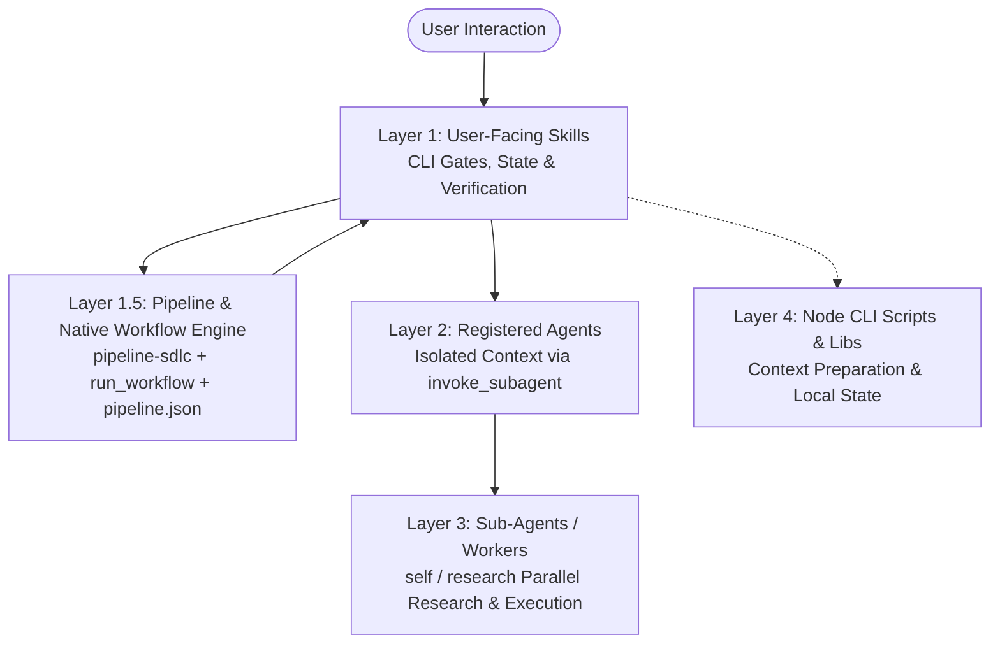

# SDLC Plugin Architecture & Agents Relation Report

This document provides a comprehensive analysis of the architecture, agent structure, inter-component relations, and model routing strategy within Lift-SDLC (18 skills, 12 registered agents).

---

## 1. Architectural Overview

Lift-SDLC is structured as a flattened, Antigravity-native multi-agent system designed to isolate heavy context processing from the main user-facing chat session. It splits responsibilities into four distinct layers:

### Layer 1: User-Facing Skills (Main Context — 18 Skills)
Slash-command skills (e.g., `/ship-sdlc`, `/plan-sdlc`, `/execute-plan-sdlc`, `/commit-sdlc`) that run directly in the user's primary conversation.
* **Responsibilities:** Interactive menus (`ask_question`), safety check gates, compiling/running tests, committing staged files, pushing to Git, and executing CLI tools (`gh`, `git`, `node`).
* **Model Inheritance:** `agy` ignores `SKILL.md` `model:` frontmatter; skills inherit the active session model and supply explicit `Model` enums (`inherit | flash_lite | flash | pro`) on `invoke_subagent` calls.
* **Isolation Strategy:** Skills delegate heavy analysis task-by-task to **Layer 2** via `invoke_subagent` (or declarative pipeline orchestration via `run_workflow`). This keeps the main chat transcript thin, avoiding context limit issues on long sessions.

### Layer 1.5: Flattened Native `run_workflow` Architecture (`pipeline-sdlc` & `workflows/*.py`)
Pipeline and fan-out skills use the declarative pipeline engine ([`pipeline-sdlc`](../skills/pipeline-sdlc/SKILL.md), replacing `run-workflow` so it never shadows `agy`'s built-in `/run-workflow`) alongside 4 native Python `run_workflow` scripts:
* **`skills/ship-sdlc/workflows/ship.py`**, **`skills/execute-plan-sdlc/workflows/execute.py`**, **`skills/review-sdlc/workflows/review.py`**, **`skills/received-review-sdlc/workflows/verify.py`**: Flatten subagent depth to **max 1** using `call_tool("run_command", ...)` for deterministic Node helper scripts, `asyncio.gather(..., return_exceptions=True)` for fault-isolated parallel fan-out, and JSON-schema-enforced `agent()` dispatches.
* **Single-level step dispatch:** `pipeline-sdlc` reads a declarative `pipeline.json` manifest, runs pre-flight prepare scripts, persists step transitions in `.sdlc/execution/`, and dispatches each `dispatchMode: "agent"` step as an isolated subagent via `invoke_subagent` (or runs `inlineHandler` steps directly in main context).
* **Deterministic post-gates:** Steps can declare `postGates` (e.g., `verify-completeness.js`, `verify-ancestry.js`) checked deterministically before advancing the state machine.

### Layer 2: Registered Subagents (Isolated Context — 12 Agents)
Registered agents defined via Markdown files in `agents/*.md` (`subagent: true`) and invoked by `TypeName` via `invoke_subagent`:
* **Orchestrators & Validators:** `plan-explore-orchestrator`, `plan-generation-orchestrator`, `plan-execution-validator`, `commit-orchestrator`, `review-orchestrator`, `received-review-orchestrator`, `harden-orchestrator`, `error-report-orchestrator`, `learn-synthesis-orchestrator`, `learn-review-only`.
* **Execution & Verification Workers:** `task-implementer`, `spec-compliance-reviewer`.
* **Hard Constraints:** Read-only orchestrators (`tools: [view_file]`) cannot call `git`, write files, or invoke external CLIs, and no subagent inherits the parent conversation transcript.

### Layer 3: Ad-hoc Sub-Agents (`self` / `research`)
Prompt-template-driven tasks dispatched in parallel by orchestrator skills or agents via `invoke_subagent` with `TypeName: "self"` or `"research"`.
* **Examples:** Plan critique lanes (5 lanes covering G1–G17), planning lens reviewers (`architecture`, `requirements`, `risk`), wave-runner coordinators, dynamic discovery subagents, and parallel code-review dimension checkers.

### Layer 4: CLI Scripts & Libraries
Programmatic helper scripts (written in Node.js with zero external npm runtime dependencies) invoked by skills via `node "<PLUGIN_ROOT>/scripts/<group>/<name>.js"` to serialize git history, calculate token budgets, validate schemas/plans/guardrails, and track state.
* **Key Modules:** [state.js](../scripts/lib/state.js) for state management, [model-tiers.js](../scripts/lib/model-tiers.js) for Gemini 4 → `agy` enum routing, and [dispatch-budget.js](../scripts/lib/dispatch-budget.js) for context constraints.

---

## 2. Component Relations & Interaction Flow

```mermaid
flowchart TD
    %% Layer 1 Nodes (Skills)
    Ship["ship-sdlc / pipeline-sdlc (Skills)"]
    Plan["plan-sdlc (Skill)"]
    Exec["execute-plan-sdlc (Skill)"]
    Commit["commit-sdlc (Skill)"]
    Review["review-sdlc (Skill)"]
    RecvReview["received-review-sdlc (Skill)"]
    Harden["harden-sdlc (Skill)"]
    ErrReport["error-report-sdlc (Skill)"]
    Learn["learn-sdlc (Skill)"]

    %% Inline Scripts (Helper CLI)
    VerifyPipe["verify-pipeline (CLI / Skill)"]
    AwaitRemote["await-remote-review (CLI Poller)"]

    %% Layer 2 Nodes (Registered Agents)
    PlanExpOrch["plan-explore-orchestrator (Agent)"]
    PlanGenOrch["plan-generation-orchestrator (Agent)"]
    PlanVal["plan-execution-validator (Agent)"]
    TaskImpl["task-implementer (Agent)"]
    SpecRev["spec-compliance-reviewer (Agent)"]
    CommitOrch["commit-orchestrator (Agent)"]
    ReviewOrch["review-orchestrator (Agent)"]
    RecvOrch["received-review-orchestrator (Agent)"]
    HardenOrch["harden-orchestrator (Agent)"]
    ErrorOrch["error-report-orchestrator (Agent)"]
    LearnSynth["learn-synthesis-orchestrator (Agent)"]
    LearnRev["learn-review-only (Agent)"]

    %% Layer 3 Nodes (Ad-hoc self / research Subagents)
    Lanes["Plan Critique Lanes (research)"]
    Lenses["Plan Lens Reviewers (research)"]
    WaveRunner["wave-runner (self)"]
    DimReview["Dimension Reviewers (research)"]
    Explorer["Code/Web Subagents (research)"]

    %% --- Ship Pipeline Execution (via pipeline-sdlc / run_workflow) ---
    Ship -->|invoke_subagent: --quality, --resume| Exec
    Exec -.->|Wave success state & files modified| Ship

    Ship -->|invoke_subagent: --auto| Commit
    Commit -.->|Commit confirmation / status| Ship

    Ship -->|invoke_subagent: --committed| Review
    Review -.->|review-comment.md path| Ship

    Ship -->|inlineHandler| VerifyPipe
    VerifyPipe -->|invoke_subagent on CI failure| Commit

    Ship -->|inlineHandler| AwaitRemote
    AwaitRemote -->|invoke_subagent on actionable verdict| RecvReview
    RecvReview -->|invoke_subagent fix commit| Commit

    %% --- Plan Scoping, Generation & Critique ---
    Plan -->|invoke_subagent| PlanExpOrch
    PlanExpOrch -.->|discovery-brief.md path| Plan
    PlanExpOrch -->|invoke_subagent| Explorer
    Explorer -.->|F-DIM-N findings| PlanExpOrch

    Plan -->|invoke_subagent| PlanGenOrch
    PlanGenOrch -.->|implementation_plan.md| Plan

    Plan -->|invoke_subagent parallel| Lanes
    Lanes -.->|Lane G1-G17 JSON verdicts| Plan

    Plan -->|invoke_subagent parallel| Lenses
    Lenses -.->|Arch/Req/Risk reviews| Plan

    %% --- Wave Execution ---
    Exec -->|invoke_subagent| PlanVal
    Exec -->|invoke_subagent| WaveRunner
    WaveRunner -.->|WAVE_SUMMARY JSON| Exec
    WaveRunner -->|invoke_subagent parallel| TaskImpl
    TaskImpl -.->|COMPLETE/VERIFY/STATUS| WaveRunner
    Exec -->|invoke_subagent| SpecRev

    %% --- Commit, Review, Received Review, Hardening, Error, Learn ---
    Commit -->|invoke_subagent| CommitOrch
    Review -->|invoke_subagent| ReviewOrch
    ReviewOrch -->|invoke_subagent parallel| DimReview
    RecvReview -->|invoke_subagent| RecvOrch
    Harden -->|invoke_subagent| HardenOrch
    ErrReport -->|invoke_subagent| ErrorOrch
    Learn -->|invoke_subagent| LearnSynth
    Learn -->|invoke_subagent| LearnRev
```

### Detailed Component Relations

| Triggering Component | Target Agent / Subagent | Communication Protocol | Purpose |
|---|---|---|---|
| [/ship-sdlc](../skills/ship-sdlc/SKILL.md) / [/pipeline-sdlc](../skills/pipeline-sdlc/SKILL.md) | Pipeline step skills (`execute-plan-sdlc`, `commit-sdlc`, `review-sdlc`, `received-review-sdlc`, `version-sdlc`, `pr-sdlc`, `verify-pipeline-sdlc`) | Declarative `pipeline.json` + `invoke_subagent` / `run_workflow` | Flattened end-to-end delivery pipeline with deterministic `postGates` and state transitions. |
| [/plan-sdlc](../skills/plan-sdlc/SKILL.md) | [plan-explore-orchestrator](../agents/plan-explore-orchestrator.md) | JSON manifest + `invoke_subagent` | Scopes requirements, creates discovery dimensions, and runs parallel research. |
| [/plan-sdlc](../skills/plan-sdlc/SKILL.md) | [plan-generation-orchestrator](../agents/plan-generation-orchestrator.md) | Discovery brief + `invoke_subagent` | Writes structured `implementation_plan.md` with wave/task metadata. |
| [/plan-sdlc](../skills/plan-sdlc/SKILL.md) | Plan Critique Lanes (0–4) & Lenses | Parallel `invoke_subagent` (`research`) | G1–G17 quality checks and cross-model Architecture/Requirements/Risk reviews. |
| [plan-explore-orchestrator](../agents/plan-explore-orchestrator.md) | Code / Web / Hybrid Subagents | Parallel `invoke_subagent` (`research`) | Explores codebase locations, reads docs, and fetches web best practices. |
| [/execute-plan-sdlc](../skills/execute-plan-sdlc/SKILL.md) | [plan-execution-validator](../agents/plan-execution-validator.md) | Plan path + `invoke_subagent` | Validates plan integrity and wave structure before dispatch. |
| [/execute-plan-sdlc](../skills/execute-plan-sdlc/SKILL.md) | `wave-runner` (`self`) | Wave manifest + `invoke_subagent` | Coordinates one wave, dispatches [task-implementer](../agents/task-implementer.md) workers, handles retries, and emits `WAVE_SUMMARY`. |
| [/execute-plan-sdlc](../skills/execute-plan-sdlc/SKILL.md) | [spec-compliance-reviewer](../agents/spec-compliance-reviewer.md) | Diff + specs + `invoke_subagent` | Verifies per-wave and cross-wave compliance against plan specs and OpenSpec deltas. |
| [/commit-sdlc](../skills/commit-sdlc/SKILL.md) | [commit-orchestrator](../agents/commit-orchestrator.md) | JSON manifest + `invoke_subagent` | Drafts conventional commit messages matching repository rules. |
| [/review-sdlc](../skills/review-sdlc/SKILL.md) | [review-orchestrator](../agents/review-orchestrator.md) | JSON manifest + `invoke_subagent` | Evaluates diffs by fanning out dimension reviewers (`research`) and persists `review-comment.md`. |
| [/received-review-sdlc](../skills/received-review-sdlc/SKILL.md) | [received-review-orchestrator](../agents/received-review-orchestrator.md) | JSON manifest + `invoke_subagent` | Verifies incoming PR review threads against code and returns `VERIFY_SUMMARY`. |
| [/harden-sdlc](../skills/harden-sdlc/SKILL.md) | [harden-orchestrator](../agents/harden-orchestrator.md) | JSON manifest + `invoke_subagent` | Classifies failures and emits strengthen-only guardrail/dimension proposals. |
| [/error-report-sdlc](../skills/error-report-sdlc/SKILL.md) | [error-report-orchestrator](../agents/error-report-orchestrator.md) | JSON manifest + `invoke_subagent` | Formats upstream `ToolingError.md` GitHub issue `{title, body}` JSON. |
| [/learn-sdlc](../skills/learn-sdlc/SKILL.md) | [learn-synthesis-orchestrator](../agents/learn-synthesis-orchestrator.md) & [learn-review-only](../agents/learn-review-only.md) | JSON manifest + `invoke_subagent` | Synthesizes candidate guardrails from recurring pending learnings and pre-screens for regressions. |

---

## 3. Complete Component Inventory (18 Skills, 12 Agents)

### A. Skills (18)
All 18 skills reside under `skills/<name>/SKILL.md` and run in the caller's inherited session model:
1. `catalog-sdlc` — Universal plan catalog and HTML delivery dashboard
2. `commit-sdlc` — Smart conventional commit workflow
3. `error-report-sdlc` — Internal upstream tooling error reporter (`user-invocable: false`)
4. `execute-plan-sdlc` — Adaptive wave-based plan executor
5. `github-sdlc` — GitHub issue CLI workflow
6. `harden-sdlc` — Post-failure guardrail/dimension hardening
7. `jira-sdlc` — Jira issue lifecycle management via MCP
8. `learn-sdlc` — Self-learning loop assimilating pending changesets into guardrails
9. `plan-guide-sdlc` — Deploys canonical `PLAN_GUIDELINES.md`
10. `plan-sdlc` — Discovery, plan generation, 5-lane G1–G17 gates, and multi-lens critique
11. `pr-sdlc` — Structured PR drafting, labeling, and publishing
12. `received-review-sdlc` — Incoming PR review verification and remediation
13. `review-sdlc` — Multi-dimension scatter-gather code review
14. `pipeline-sdlc` — Declarative pipeline manifest runner (`pipeline.json`)
15. `setup-sdlc` — Unified interactive setup and migration wizard
16. `ship-sdlc` — End-to-end delivery pipeline built on `pipeline-sdlc` / native `run_workflow`
17. `verify-pipeline-sdlc` — CI failure classification and minimal remediation
18. `version-sdlc` — SemVer bumping, changelog updates, and release tagging

### B. Registered Agents (12)
Defined in `agents/*.md` with Gemini 4 model profiles mapped via `scripts/lib/model-tiers.js::toAgyModelEnum`:

| Agent | Gemini 4 Profile | `agy` Enum | Role |
|---|---|---|---|
| `commit-orchestrator` | `gemini-4-hydrogen-low` | `flash_lite` | Subject & body construction |
| `error-report-orchestrator` | `gemini-4-hydrogen-medium` | `flash` | Structured issue template filler |
| `harden-orchestrator` | `gemini-4-argon-low` | `pro` | Failure classification & hardening proposals |
| `learn-review-only` | `gemini-4-hydrogen-high` | `flash` | Read-only guardrail regression pre-screen |
| `learn-synthesis-orchestrator` | `gemini-4-argon-medium` | `pro` | Candidate guardrail synthesis |
| `received-review-orchestrator` | `gemini-4-hydrogen-medium` | `flash` | PR thread clustering & verifier fan-out |
| `review-orchestrator` | `gemini-4-hydrogen-high` | `flash` | Dimension reviewer fan-out & deduplication |
| `plan-explore-orchestrator` | `gemini-4-hydrogen-high` | `flash` | Dynamic discovery dimension scoping |
| `plan-execution-validator` | `gemini-4-argon-low` | `pro` | Plan DAG & wave conflict validation |
| `task-implementer` | `gemini-4-hydrogen-medium` / `neon-*` *(tier-routed)* | `flash` / `pro` | Per-task implementation from fact sheet |
| `spec-compliance-reviewer` | `gemini-4-argon-low` / `argon-medium` | `pro` | Wave and cross-wave spec compliance audit |
| `plan-generation-orchestrator` | `gemini-4-carbon-medium` / `carbon-high` / `argon-medium` | `pro` | Deep multi-wave architectural plan drafting |

### C. Quality Presets & Failure-Aware Escalation Ladder
- **`minimal` (Speed):** Trivial `gemini-4-hydrogen-medium` (`flash`), Standard `gemini-4-hydrogen-medium` (`flash`), Complex `gemini-4-hydrogen-high` (`flash`).
- **`balanced` (Default):** Trivial `gemini-4-hydrogen-medium` (`flash`), Standard `gemini-4-neon-low` (`pro`, or `inherit` via `execute.standardWorkerEnum`), Complex `gemini-4-neon-medium` (`pro`).
- **`full` (Quality):** Trivial `gemini-4-hydrogen-medium` (`flash`), Standard `gemini-4-neon-medium` (`pro`), Complex `gemini-4-carbon-medium` (`pro`).
- **`wave-runner`:** Locked to `flash` (`gemini-4-hydrogen-medium`).
- **Failure-Aware Escalation (`escalateLogicalModel` in `scripts/lib/model-tiers.js`):** `NEEDS_CONTEXT` keeps the current tier; `SPEC_GAP` jumps to Argon (`pro`); `FAILED_TESTS` / `FAILED_BUILD` / `BLOCKED` steps `hydrogen → neon → argon → carbon` (`agy` enums `flash_lite → flash → pro`).

---

## 4. State Persistence, Telemetry, and Resume Patterns

Lift-SDLC operates a **local-only** session tracking system. No telemetry data leaves the developer's computer.

### A. State Files
State files are written atomically (`temp write` + `rename` pattern) in the main worktree directory under `.sdlc/execution/`.
* **Path Pattern:** `<main-worktree>/.sdlc/execution/<prefix>-<branchSlug>-<timestamp>.json`
* **JSON Structure:** Stores active branch names, step statuses, resolved CLI flags, and metadata such as the `committedSha` of completed execution waves.

### B. Compact Recovery & Enforcement Hook Ring (9 Hooks)
Since conversation history may be compacted across long runs, 9 Antigravity hooks (`SessionStart`, `PreToolUse` ×4, `PostInvocation`, `Stop` ×3) preserve state and enforce safety via `hooks/lib/hook-context.js` (resolving workspace from `stdin.cwd` / `stdin.workspacePaths[0]` and formatting system messages as `{ injectSteps: [{ systemMessage: { systemMessage } }] }`):
* **`session-start.js` (`SessionStart` Hook):** Fires once on session start/compact and injects active pipeline details back into context when a recovery file is present.
* **`stop-state-save.js` (`Stop` Hook):** Fires after each turn, persisting recovery state to `.sdlc/execution/.compact-recovery-<branchSlug>.json`.
* **`stop-block.js` & `stop-plan-integrity.js` (`Stop` Hooks):** Prevent premature turn termination during active pipelines or incomplete plan integrity checkpoints (gating on `terminationReason !== 'NO_TOOL_CALL'` and `continuationActive === true`).
* **Guard & Nudge Hooks:** `pre-tool-git-guard.js`, `question-suppression.js`, `pre-tool-jira-write-guard.js`, `pre-tool-validate.js` (`PreToolUse`), and `post-tool-nudge.js` (`PostInvocation`).
* **TTL (Time to Live):** Compact recovery files are valid for 1 hour. Stale files (>24 hours) are cleaned up automatically.

### C. Resume Types
* **Ship Resume:** Invoked via `/ship-sdlc --resume`. Re-loads ship state from disk and resumes at the first pending step.
* **Execute Resume:** Invoked via `/execute-plan-sdlc --resume`. Re-runs wave execution at the first incomplete wave, checking `committedSha` reachability to prevent duplicate execution of committed waves.

---

## 5. Token Budgets & Fan-Out Sizing

Parallel worker dispatches (such as fanning out plan lanes or multiple review dimensions) are gated by a context-budget calculator in [dispatch-budget.js](../scripts/lib/dispatch-budget.js).

1. **Input Budget Allocation:** The engine reserves **75%** of the model's total context window for inputs (templates, guardrails, diffs, logs), leaving **25%** for reasoning output space (scaled to **65% input / 35% output** for `-xhigh` variants and `gemini-4-carbon-high` via `getReservedRatio`).
   * Gemini 4 models (`gemini-4-hydrogen`, `gemini-4-neon`, `gemini-4-argon`, `gemini-4-carbon`) all share a 1M token context ceiling (~3MB input budget at 75% reserve).
2. **Task Pack Algorithm:** Candidate tasks are sorted by their fact-sheet sizes in ascending order. The budget calculator packs tasks until the byte budget is consumed or the static concurrency limits are reached.
3. **Static Concurrency Caps:**

| Remaining Tasks | Maximum Concurrent Dispatches |
|---|---|
| 1–3 | No limit (runs all) |
| 4–8 | Max 4 parallel agents |
| 9–15 | Max 5 parallel agents |
| 16+ | Max 6 parallel agents |

---

## 6. Key Architecture References

For deeper design decisions, config files, and implementation details:
* **Telemetry Details:** Refer to [telemetry-and-state-tracking.md](./telemetry-and-state-tracking.md)
* **Model Configurations:** Refer to [model-references.md](./model-references.md)
* **Quality Setup:** Refer to [quality-tiers.md](./quality-tiers.md)
* **Token Budget Calculator:** Code in [dispatch-budget.js](../scripts/lib/dispatch-budget.js)
* **Model Tier Mapping:** Code in [model-tiers.js](../scripts/lib/model-tiers.js)
* **State Manager:** Code in [state.js](../scripts/lib/state.js)
